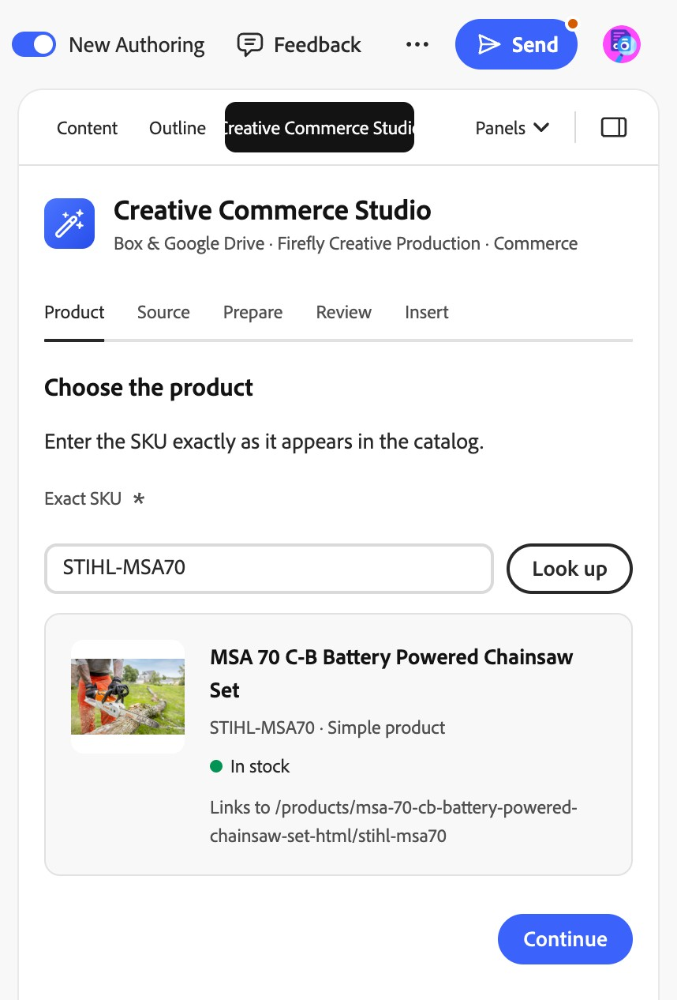
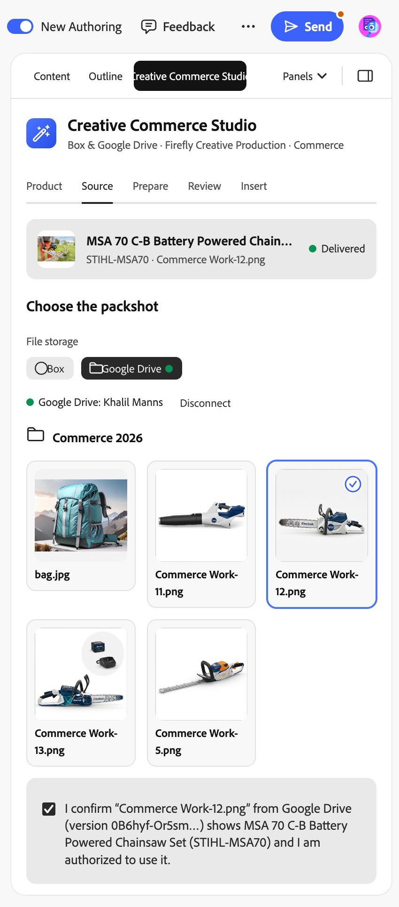
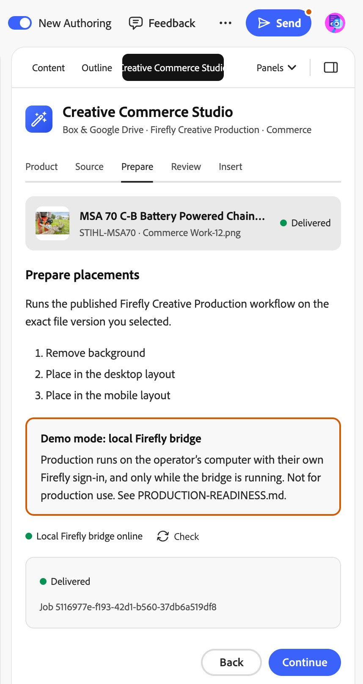
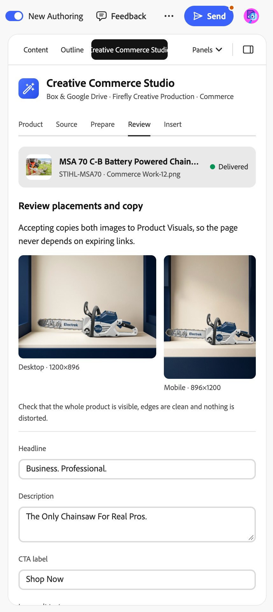
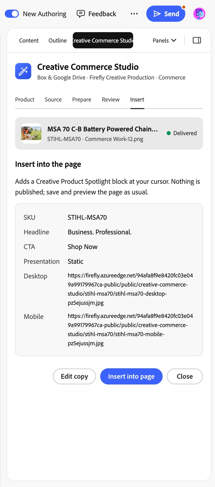
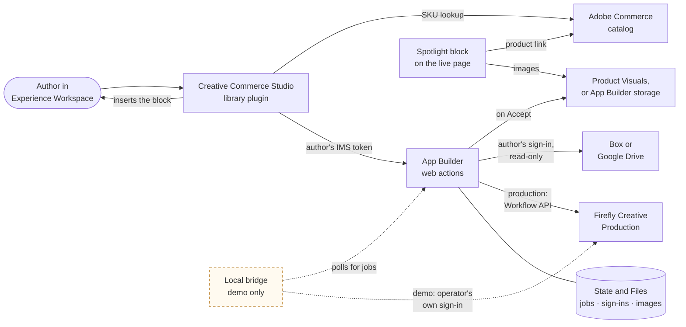
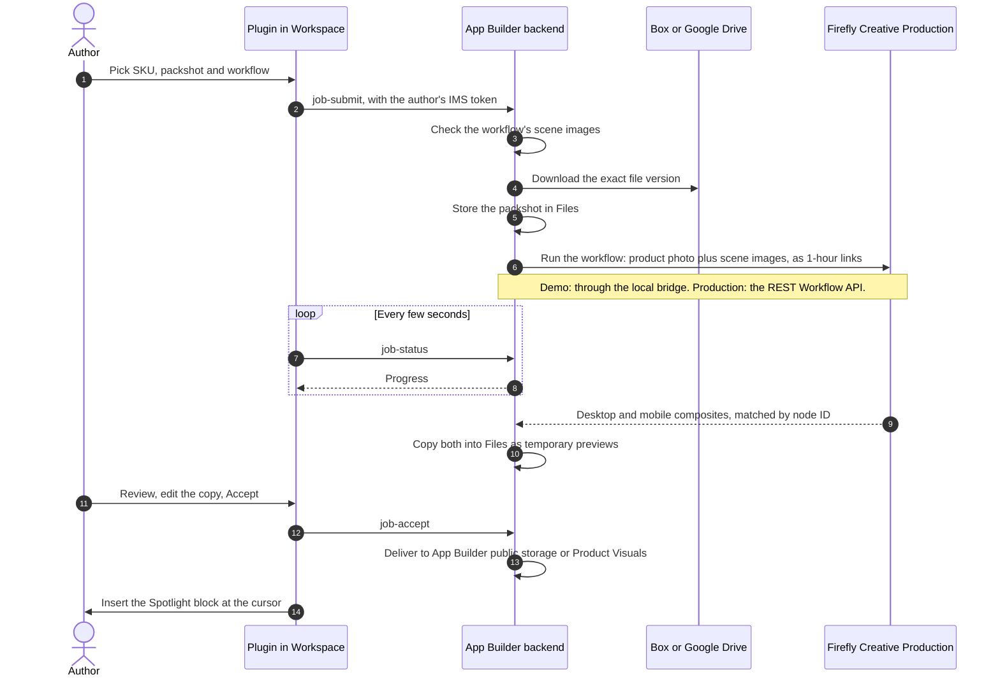

# Creative Commerce Studio

**Turn product masters in Box or Google Drive into shoppable, placement-ready storefront banners without leaving Adobe Experience Workspace.**

An author picks a product by SKU, chooses an authorized packshot from Box or Google Drive, and runs a published **Firefly Creative Production** workflow that produces desktop and mobile compositions. They review the result, then insert a **Creative Product Spotlight** block at the cursor. On the storefront, the block links to the live **Adobe Commerce** product.

## Video walkthrough

https://github.com/user-attachments/assets/f4f1c8ff-22bf-4bd1-8d05-bd5e54fbb888

A 7:06 walkthrough, recorded on 2026-11-19. It shows the Commerce storefront, then Creative Commerce Studio in Experience Workspace, including choosing a **Campaign Look** on the Prepare step and running it through the local Firefly bridge. If the player doesn't appear, [open the video directly](https://github.com/user-attachments/assets/f4f1c8ff-22bf-4bd1-8d05-bd5e54fbb888).

## Screenshots

The plugin in Experience Workspace's side panel, from a real end-to-end run (Google Drive → Firefly Creative Production → insert).

<table>
  <tr>
    <td align="center"><br><sub><b>1. Product</b>: exact-SKU lookup</sub></td>
    <td align="center"><br><sub><b>2. Source</b>: Box or Google Drive, confirm the file</sub></td>
    <td align="center"><br><sub><b>3. Prepare</b>: Firefly Creative Production run</sub></td>
  </tr>
  <tr>
    <td align="center"><br><sub><b>4. Review</b>: placements and copy</sub></td>
    <td align="center"><br><sub><b>5. Insert</b>: block at the cursor</sub></td>
    <td></td>
  </tr>
</table>

> [!WARNING]
> **This is a working demo, not a production-ready integration.**
> - **Firefly runs:** they go through a **local bridge** on one operator's computer, with that operator's own Adobe sign-in, because no Firefly Services API credential was available.
> - **Image storage:** approved images go to App Builder public storage rather than Product Visuals (AEM Assets).
> - **Google Drive:** it runs as an unverified app in Testing mode.
>
> Everything needed to make it production-ready (APIs, credentials, roles, entitlements and approvals) is listed in [Production readiness](#production-readiness) below and in detail in **[docs/PRODUCTION-READINESS.md](docs/PRODUCTION-READINESS.md)**.

---

## Contents

- [Video walkthrough](#video-walkthrough)
- [Screenshots](#screenshots)
- [Before you start](#before-you-start)
  - [1. Application requirements](#1-application-requirements)
  - [2. Access requirements](#2-access-requirements)
  - [3. Values, credentials and secrets you'll fill in](#3-values-credentials-and-secrets-youll-fill-in)
- [What it does](#what-it-does)
- [How it works](#how-it-works)
  - [A run, step by step](#a-run-step-by-step)
- [Repository layout](#repository-layout)
- [Production readiness](#production-readiness)
- [Install](#install)
- [Using it](#using-it)
- [Configuration reference](#configuration-reference)
- [Security](#security)
- [Development](#development)
- [Known limitations](#known-limitations)
- [Roadmap](#roadmap)
- [License](#license)

## Before you start

To run Creative Commerce Studio you need **all of these**:

1. **An Edge Delivery Services Commerce storefront** in Adobe Experience Workspace (Document Authoring), based on AEM Boilerplate Commerce.
2. **An Adobe Commerce catalog** the storefront reads: Adobe Commerce as a Cloud Service or Adobe Commerce Optimizer.
3. **Adobe App Builder**, with the **Developer** role, for the backend (Node 22 and the `aio` CLI).
4. **Box and/or Google Drive**, with an OAuth app you can create, and a campaign folder of authorized packshots.
5. **Firefly Creative Production**, with a **published workflow**. To run it, either someone who keeps the local bridge running (demo) or a Firefly Services server-to-server credential (production).

**Optional:** Product Visuals (AEM Assets with Dynamic Media with OpenAPI), for governed image delivery.

The tables below give the detail: [what each part is for](#1-application-requirements), [who needs which access](#2-access-requirements) and [every value you'll fill in](#3-values-credentials-and-secrets-youll-fill-in). Then follow [Install](#install).

### 1. Application requirements

| Component | Required? | Used for | Notes |
|---|---|---|---|
| **Adobe Experience Workspace** site on **Edge Delivery Services** (Document Authoring) | Required | Hosts the library plugin; authors insert the block | The plugin uses the Workspace SDK (`https://da.live/nx/utils/sdk.js`) |
| **AEM Boilerplate Commerce** storefront | Required | The block imports `CS_FETCH_GRAPHQL` and `getProductLink` from the site's `scripts/commerce.js` | Any site based on the Commerce boilerplate |
| **Adobe Commerce** catalog: **Adobe Commerce as a Cloud Service** or **Adobe Commerce Optimizer** | Required | SKU lookup and the live product link (`products(skus:)` storefront query) | Tested with Adobe Commerce Optimizer. Uses the site's public `commerce-endpoint` and headers. No admin or catalog writes |
| **Adobe App Builder** (Developer Console project and workspace, I/O Runtime, State, Files) | Required | The backend | Node 22, `aio` CLI |
| **Box** (OAuth 2.0 "User Authentication" app) | At least one of Box / Drive | Source packshots | Free developer accounts work |
| **Google Drive** (Google Cloud OAuth client, Web application, Drive API) | At least one of Box / Drive | Source packshots | Testing-mode OAuth for demos |
| **Firefly Creative Production** | Required | Image production | At least one **published workflow** with a product-image input and desktop and mobile composite outputs, optionally with fixed scene images such as backgrounds and masks ([docs/FFCPE-WORKFLOW.md](docs/FFCPE-WORKFLOW.md)) |
| **Product Visuals** (AEM Assets as a Cloud Service) with **Dynamic Media with OpenAPI** | Optional (recommended for production) | Durable, governed image delivery | Without it, images go to App Builder public storage |
| Authorized creative | Required | Packshots, backgrounds and templates you are allowed to use and publish | — |

### 2. Access requirements

These are the accounts and roles needed to run the extension as it is today, in demo mode. What production needs is in [Production readiness](#production-readiness).

| Who | Needs |
|---|---|
| **Site admin** | Write access to the site's code repo (adds the block, plugin and one config value). Access to the Workspace site config to add a **library** row. |
| **Backend operator** | An Adobe org with **App Builder**, the **Developer** role in that org, a Developer Console project and workspace, and Node 22 with the `aio` CLI. |
| **Box admin** | Creates the Box OAuth app. In enterprise Box, approves it under **Admin Console → Platform Apps**, added by Client ID. |
| **Google admin** | A Google Cloud project with the **Drive API** enabled, and an OAuth consent screen (External, Testing) with authors listed as **test users**. |
| **Firefly operator (bridge)** | Firefly Creative Production **user access** that can run the published workflow, and a computer running `npm run bridge` during use. All runs use this operator's identity. |
| **Authors** | Edit access to the Workspace site, plus a Box and/or Google account with access to the campaign folder. |

### 3. Values, credentials and secrets you'll fill in

`<backend>` below means your backend URL, `https://<namespace>.adobeioruntime.net/api/v1/web/creative-commerce-studio`, where `<namespace>` is your App Builder workspace's Runtime namespace. **Secrets** go only in `backend/.env`, which is gitignored. Never commit them or paste them anywhere else.

**Backend: `backend/.env`.** Start from [`backend/.env.example`](backend/.env.example), then deploy with `aio app deploy --force-deploy`.

| Setting | Needed for | Secret | Where to get it |
|---|---|---|---|
| `AIO_runtime_namespace`, `AIO_runtime_auth` | always | **yes** | Written for you by `aio app use` |
| `ALLOWED_ORIGINS` | always | no | Your hosts: `https://da.live`, `https://main--<site>--<org>.preview.da.live` (Workspace's plugin proxy), and your `.aem.page` and `.aem.live` hosts |
| `IMS_ALLOWED_CLIENT_IDS` | always | no | `darkalley`, Experience Workspace's sign-in client |
| `IMS_ALLOWED_ORGS` | optional | no | Your IMS org ID (`…@AdobeOrg`, Admin Console), to limit use to your org |
| `TOKEN_ENCRYPTION_KEY` | always | **yes** | Generate one: `openssl rand -base64 32`. It encrypts stored Box, Google and Firefly sign-ins |
| `BOX_CLIENT_ID`, `BOX_CLIENT_SECRET` | Box | secret: **yes** | Box Developer Console → your OAuth 2.0 (User Authentication) app → Configuration |
| `BOX_REDIRECT_URI` | Box | no | `<backend>``/box-auth-callback`. Register the exact same URL in the Box app |
| `BOX_ALLOWED_FOLDER_ID` | Box | no | The number at the end of the campaign folder's Box URL |
| `GDRIVE_CLIENT_ID`, `GDRIVE_CLIENT_SECRET` | Google Drive | secret: **yes** | Google Cloud console → APIs & Services → Credentials → OAuth client ID (Web application) |
| `GDRIVE_REDIRECT_URI` | Google Drive | no | `<backend>``/gdrive-auth-callback`. Add it as an Authorized redirect URI on the OAuth client |
| `GDRIVE_ALLOWED_FOLDER_ID` | Google Drive | no | The ID at the end of the folder's Drive URL (`…/drive/folders/<ID>`) |
| `FFCPE_MODE` | always | no | `bridge` (demo, local bridge) or `api` (production, server-to-server credential) |
| `BRIDGE_TOKEN` | bridge mode | **yes** | Generate one: `openssl rand -hex 32`. The bridge reads the same `.env` |
| `CCS_BACKEND_URL` | bridge mode, uploads | no | `<backend>` |
| `ADMIN_TOKEN` | uploads outside bridge mode | **yes** | Generate one: `openssl rand -hex 32` |
| `FFCPE_CLIENT_ID`, `FFCPE_CLIENT_SECRET`, `FFCPE_IMS_ORG_ID` (+ optional `FFCPE_IMS_USER_ID`) | api mode | secret: **yes** | Developer Console project in the Firefly org → Firefly Services API → OAuth Server-to-Server credential |
| `DELIVERY_MODE` | optional | no | `public` (App Builder public storage, the default) or `aem` |
| `AEM_AUTHOR_URL`, `AEM_DELIVERY_URL`, `AEM_CLIENT_ID`, `AEM_CLIENT_SECRET`, `AEM_SCOPES`, `AEM_TARGET_FOLDER` | aem delivery | secret: **yes** | Your AEM as a Cloud Service environment, plus a Developer Console OAuth Server-to-Server credential with AEM API access |

**Workflows: `backend/workflows.json`.** Copy [`backend/workflows.example.json`](backend/workflows.example.json), fill it in, then run `npm run workflows:upload`. Nothing in it is secret.

| Value | Where to get it |
|---|---|
| `workflowId` | The **published** workflow's execution ID in Firefly Creative Production, not the editable Builder source ID |
| `productNodeId`, `desktopNodeId`, `mobileNodeId` | Node IDs of the product-photo input and the final desktop and mobile composites. They're in the published workflow's generated API request (Execute Graph / cURL) |
| `inputs` (optional) | For workflows with scene images: each input's node ID, plus the image file you put under `backend/looks/` |

**Site and Workspace.** Nothing here is secret.

| Where | Value |
|---|---|
| Site repo `config.json` (`public.default`) | `"creative-commerce-studio": { "backend-url": "<backend>" }`. The storefront's existing `commerce-endpoint` and headers are reused as they are |
| Workspace site config → **library** sheet | Title `Creative Commerce Studio`; path `https://main--<site>--<org>.aem.page/tools/creative-commerce-studio/creative-commerce-studio.html`; image `…/tools/creative-commerce-studio/icon.svg` |
| Box app / Google OAuth client | The redirect URIs above. In enterprise Box, approve the app under Admin Console → Platform Apps. In Google, list the authors as **test users** on the consent screen |

The full list of settings, including the advanced ones, is in [Configuration reference](#configuration-reference).

**After installing,** open the plugin. The **Setup check** at the top of the Product step confirms each part:

- **What it checks:** Workspace, Commerce catalog, backend and sign-in, encryption key, file sources, Firefly mode and bridge, workflows and their scene images, and delivery.
- **What it shows:** each gap with who fixes it (**Site admin** or **You**) and a link to the fix. It reports only whether each part is set up, never secret values.

## What it does

The Workspace library plugin walks the author through five steps. To see it in action, watch the [video walkthrough](#video-walkthrough) or browse the [screenshots](#screenshots).

| Step | What happens |
|---|---|
| **Product** ([screenshot](docs/images/01-product.jpg)) | Exact-SKU lookup against the site's own Commerce catalog endpoint and store context. Shows name, type, stock and the product page link. |
| **Source** ([screenshot](docs/images/02-source.jpg)) | Pick **Box** or **Google Drive** and connect your own account. Browse one allowed campaign folder with thumbnails, choose a PNG or JPEG packshot, and **confirm** that it shows the product and that you may use it. |
| **Prepare** ([screenshot](docs/images/03-prepare.jpg)) | Pick a **workflow** from the site's curated list, then run that published Firefly Creative Production workflow on the **exact file version** you chose, for example background removal and then desktop and mobile composites. A progress bar shows while it runs. |
| **Review** ([screenshot](docs/images/04-review.jpg)) | Preview both placements. Edit headline, description, CTA label and alt text. Choose a **static** or **animated** presentation. **Accept** stores the images permanently. |
| **Insert** ([screenshot](docs/images/05-insert.jpg)) | Inserts a `creative-product-spotlight` block at the cursor. Nothing is published; the author saves and previews as usual. **New banner** starts over, and **Another for <SKU>** reuses the product. Connections and the workflow choice are kept. |

On the storefront the block renders the responsive image, which is never cropped, plus the editable HTML copy and a native CTA. The CTA's product link is **resolved from Commerce at runtime**. If the SKU no longer exists, the CTA is hidden instead of linking to a missing product. The optional animated presentation is a one-time entrance, about 1.3 s, and is disabled for visitors who prefer reduced motion.

## How it works



Solid lines are always used. Dashed lines are the **demo-only** local bridge, which production replaces with the Workflow API.

| Connection | How it's secured |
|---|---|
| Plugin → App Builder | The author's Experience Workspace (IMS) token, validated with Adobe IMS on every call. The plugin only calls the backend URL in the site's `config.json`. |
| Plugin → Commerce catalog | The storefront's own public catalog endpoint and headers from `config.json`. Read-only, no admin access. |
| App Builder → Box / Google Drive | Each author's own OAuth sign-in (Google's with PKCE). Read-only, limited to one campaign folder. Stored encrypted with `TOKEN_ENCRYPTION_KEY`. |
| App Builder → Firefly, **production** | The Workflow API with an OAuth server-to-server credential. Firefly fetches the packshot and any scene images through 1-hour links to private App Builder Files. |
| Local bridge → App Builder, **demo** | `BRIDGE_TOKEN`. The bridge runs each workflow through the run-workflow MCP with the operator's own Adobe sign-in. |
| App Builder → approved images | Product Visuals with an OAuth server-to-server credential (`DELIVERY_MODE=aem`), or App Builder public storage (`public`). |
| Plugin → page | `actions.sendHTML` inserts the block at the cursor. Nothing is published. |
| Live page | The block gets the product link from Commerce at runtime and shows the approved images. |

The secrets (Box, Google and Adobe credentials, and the encryption key) exist only as App Builder action inputs. The browser never sees a third-party token, and published pages contain only the SKU, the copy and the image URLs.

### A run, step by step



## Repository layout

| Path | What it is | Where it goes |
|---|---|---|
| [`plugin/`](plugin/) | Experience Workspace **library plugin** (vanilla JS + Spectrum Web Components, Spectrum 2 theme, pre-bundled in `plugin/vendor/`) | Your site repo: `tools/creative-commerce-studio/` |
| [`block/creative-product-spotlight/`](block/creative-product-spotlight/) | The **Creative Product Spotlight** EDS block | Your site repo: `blocks/creative-product-spotlight/` |
| [`backend/`](backend/) | **App Builder** project: web actions, tests, the local Firefly bridge | Deployed with `aio app deploy` |
| [`docs/PRODUCTION-READINESS.md`](docs/PRODUCTION-READINESS.md) | What production use requires, per service | — |
| [`docs/FFCPE-WORKFLOW.md`](docs/FFCPE-WORKFLOW.md) | How to build and publish the Firefly workflow | — |
| [`docs/videos/`](docs/videos/) | An earlier 4:23 walkthrough from 2026-11-15, download only. The current video is at the [top](#video-walkthrough) | — |
| [`backend/README.md`](backend/README.md) | Detailed operator guide: every service's setup, deploy, troubleshooting | — |

## Production readiness

> [!IMPORTANT]
> The code for the production path is already built (`FFCPE_MODE=api`, `DELIVERY_MODE=aem`) and covered by automated tests, but **neither route has run against the live service yet**, because no Firefly Services or AEM API credential was available. What's missing is **access**, then a first supervised run to confirm the live request and response details. The table lists the Adobe Developer Console APIs, credentials and roles each service needs. Full checklist: **[docs/PRODUCTION-READINESS.md](docs/PRODUCTION-READINESS.md)**.

| Service | Developer Console API / credential | Entitlement & roles | Approvals & other work |
|---|---|---|---|
| **Firefly Creative Production** (replaces the local bridge) | **Firefly Services: Creative Production Workflow API** with an **OAuth Server-to-Server** credential (scopes `openid, AdobeID, session, additional_info, read_organizations, firefly_api, ff_apis`). REST contract: `https://run-workflow.adobe.io/openapi.json`. | Firefly Services **API** entitlement in the org that owns the workflows; browser access isn't enough. The **Developer** role on that product profile, granted by a System or Product Admin. | The credential's **technical account must be allowed to run the published workflow**. Confirm quota, rate limits and billing. |
| **Product Visuals / AEM Assets** | **AEM** API access (Assets Author API) with an **OAuth Server-to-Server** credential | AEM as a Cloud Service with **Dynamic Media with OpenAPI**. The **Developer** role in the AEM org. | The AEM environment must **allow the technical account** (Cloud Manager API access configuration), with write and approve rights on the target DAM folder. Agree an approval policy. |
| **App Builder** | App Builder project with a **Production** workspace (I/O Runtime, State, Files) | App Builder entitlement and the **Developer** role in the hosting org | Deploy from CI/CD, use managed secrets with rotation, monitoring, and a data-retention plan. Remove `BRIDGE_TOKEN`. |
| **Identity (Experience Workspace)** | None. Author tokens are validated with IMS. | — | Confirm the Workspace IMS client ID (`IMS_ALLOWED_CLIENT_IDS`, currently `darkalley`). Restrict to customer orgs with `IMS_ALLOWED_ORGS`. |
| **Box** | Box OAuth app (read-only scope) | — | **Enterprise admin approval** in every customer's Box. |
| **Google Drive** | Google OAuth client | — | `drive.readonly` is a **restricted scope**: **Google app verification plus an annual CASA security assessment** (weeks). Alternatively switch to `drive.file` + Google Picker (a code change). Google Workspace admins must allow the app. |
| **Marketplace / distribution** | — | — | Confirm the Experience Workspace marketplace listing and review requirements, per-customer configuration, and a security and privacy review. |

Each service's credential must come from a Developer Console project in **the org that owns that service**. Workspace, App Builder, Firefly and AEM may each be in a different IMS org, and one backend can hold credentials from several of them.

## Install

The short version is below. Every step is detailed in **[backend/README.md](backend/README.md)**.

1. **Create the App Builder project**: Developer Console → *Create project from template* → **App Builder**. Note the workspace's **Runtime namespace**; your backend URL will be `https://<namespace>.adobeioruntime.net/api/v1/web/creative-commerce-studio`.
2. **Set up a source.** For **Box**: an OAuth 2.0 app with redirect `<backend>/box-auth-callback` and a campaign folder ID. For **Google Drive**: an OAuth client (Web) with redirect `<backend>/gdrive-auth-callback`, the Drive API enabled, test users, and a folder ID. Set up one or both.
3. **Build and publish the Firefly workflow** ([docs/FFCPE-WORKFLOW.md](docs/FFCPE-WORKFLOW.md)), and note the workflow ID and the product, desktop and mobile node IDs. Copy `backend/workflows.example.json` to `backend/workflows.json` and fill them in, along with any scene images the workflow needs (see [Choosing a workflow](#choosing-a-workflow)).
4. **Configure and deploy the backend:**
   ```bash
   cd backend
   npm install -g @adobe/aio-cli
   aio login
   aio app use --global          # or: aio app use <workspace.json>; choose "merge" for .env
   # append the variables from .env.example to the .env that aio created, and fill them in
   npm install && npm test
   aio app deploy --force-deploy
   npm run workflows:upload      # the workflow list and any scene images
   ```
5. **Add the block and the plugin to your site repo**:
   - copy `block/creative-product-spotlight/` to `blocks/creative-product-spotlight/`
   - copy `plugin/` to `tools/creative-commerce-studio/`; `plugin/build/` is optional, and if you keep it, add `tools/creative-commerce-studio/build/*` to `.hlxignore`
   - in the site's `config.json` (`public.default`), add:
     ```json
     "creative-commerce-studio": { "backend-url": "https://<namespace>.adobeioruntime.net/api/v1/web/creative-commerce-studio" }
     ```
6. **Allow the plugin's origins** in the backend's `ALLOWED_ORIGINS`: `https://da.live`, `https://<branch>--<site>--<org>.preview.da.live` (Workspace serves plugins through this proxy), and your `.aem.page` and `.aem.live` hosts. Redeploy.
7. **Register the plugin**: Workspace site config `https://da.live/config#/<org>/<site>/` → **library** sheet, add a row with title `Creative Commerce Studio` and path `https://main--<site>--<org>.aem.page/tools/creative-commerce-studio/creative-commerce-studio.html`. For the row's **image** column you can use the bundled icon: `https://main--<site>--<org>.aem.page/tools/creative-commerce-studio/icon.svg`.
8. **Firefly (demo mode)**: on the operator's computer, in `backend/`, run `npm run bridge:login` once, then keep `npm run bridge` running during use. For production, use `FFCPE_MODE=api` with the server-to-server credential instead.

## Using it

1. Open a page in Experience Workspace, then **Library → Creative Commerce Studio**. If the **Setup check** at the top shows anything to fix, follow its links first.
2. **Product**: enter an exact SKU and **Look up**.
3. **Source**: choose **Box** or **Google Drive**, connect, open the folder, pick a packshot, and tick the confirmation.
4. **Prepare**: choose the **workflow** (for example a Campaign Look) if the site offers several, then **Run production**. With the bridge, the run starts as soon as the bridge picks it up. The progress bar and elapsed time show while Firefly works, which can take up to about 10 minutes.
5. **Review**: check both placements, edit the copy, choose **Static** or **Animated entrance**, then **Accept and deliver**.
6. **Insert**: **Insert into page**, then save and preview the page as usual. To make another, choose **New banner**, or **Another for <SKU>** to keep the same product. The finished banner stays under **Recent jobs** on the Product step.

The block can also be authored by hand. It's a two-column key/value table with these rows: `SKU`, `Headline`, `Description`, `Desktop image`, `Mobile image`, `Image alt`, `CTA label`, `Presentation` (`static` | `animated`). See [block/creative-product-spotlight/README.md](block/creative-product-spotlight/README.md).

### Choosing a workflow

Authors choose the Firefly Creative Production workflow on the **Prepare** step, from a list the site admin configures. With several workflows, they appear as radio buttons, each showing its description and steps. With one, the step just shows its name.

#### The workflow list

Keep the list in `backend/workflows.json`, a JSON array where the first entry is the default. Start from `backend/workflows.example.json`. Upload it with `npm run workflows:upload` (see below). Changes apply to the next run, with no redeploy. Each entry is one choice authors see:

| Field | Required | Meaning |
|---|---|---|
| `key` | yes | Short ID: lowercase letters, digits, dashes |
| `label` | yes | Name authors see |
| `description`, `steps` | no | One-line description and a list of step names shown under the choice |
| `workflowId` | yes | The **published** workflow's execution ID, not the editable Builder source's ID |
| `productNodeId` | yes | The image input that receives the author's product photo |
| `desktopNodeId`, `mobileNodeId` | yes | The final desktop and mobile composite nodes. Outputs are picked by these node IDs, never by order or file name |
| `inputs` | no | Fixed images sent with every run of this entry, such as a scene background and its placement mask. Each has `nodeId`, `file` (a path under `looks/`), an optional `role` (`desktop-background`, `desktop-mask`, `mobile-background`, `mobile-mask` or `other`) and optional `width` and `height` |

Where the list comes from, first match wins:

1. `FFCPE_WORKFLOWS` in `.env`, a one-line JSON array in the same format. It needs `aio app deploy --force-deploy` after each change, and the upload command warns if it's set, because it hides the uploaded list.
2. The uploaded `workflows.json`.
3. A single workflow from `FFCPE_WORKFLOW_ID` and the three `FFCPE_*_NODE_ID` values, with an optional `FFCPE_WORKFLOW_LABEL`. Existing installs keep working unchanged.

#### Workflows with scene images (for example Campaign Looks)

Some workflows need more than the product photo. A "Campaign Looks" workflow, for instance, composites the product into a pre-approved scene, and it needs that scene's desktop and mobile **background** plus a **placement mask** for each. In the list, make **one entry per look**. Every entry uses the same `workflowId` and node IDs, and its own four `inputs`:

```json
{
  "key": "look-workshop",
  "label": "Campaign Look: Workshop",
  "workflowId": "<published-workflow-id>",
  "productNodeId": "<product-photo-input-node>",
  "desktopNodeId": "<desktop-composite-node>",
  "mobileNodeId": "<mobile-composite-node>",
  "inputs": [
    { "nodeId": "<desktop-background-input-node>", "file": "looks/workshop/workshop-desktop-background.jpg", "role": "desktop-background" },
    { "nodeId": "<desktop-mask-input-node>", "file": "looks/workshop/workshop-desktop-mask.png", "role": "desktop-mask" },
    { "nodeId": "<mobile-background-input-node>", "file": "looks/workshop/workshop-mobile-background.jpg", "role": "mobile-background" },
    { "nodeId": "<mobile-mask-input-node>", "file": "looks/workshop/workshop-mobile-mask.png", "role": "mobile-mask" }
  ]
}
```

Authors only pick the product, the photo and the look. The scene images stay hidden:

- **Storage:** they're kept in the backend's **private** App Builder storage, never under `public/`.
- **Links:** every run gets fresh 1-hour links to them.
- **Each run is one product with one look.** Don't put several looks' images into one entry: the workflow could pair them up in unintended combinations.

**Upload the list and the images** from the backend folder on your computer, the same folder you deploy from. The command uploads **through the deployed backend**: the backend hands out 10-minute upload links, so your computer needs no storage credentials. It needs `CCS_BACKEND_URL` plus a token in that folder's `.env`:

- **Bridge mode:** the existing `BRIDGE_TOKEN` works.
- **Otherwise:** set `ADMIN_TOKEN`, 32+ random characters (for example from `openssl rand -hex 32`), and redeploy.

Without those settings, or with `--direct`, it writes straight to App Builder storage using the `AIO_runtime_*` values that `aio app use` writes.

1. Put each image at its `file` path under `backend/looks/`, for example `backend/looks/workshop/workshop-desktop-mask.png`. Give every file a unique name, such as the look's name followed by its part, so they can't be mixed up in Firefly either. Images in that folder aren't committed.
2. `npm run workflows:check` validates the list and every image and uploads nothing. It checks that:
   - every file is present and really is a PNG or JPEG, and its extension matches its real type: renaming a `.png` to `.jpg` doesn't convert it
   - masks are PNG
   - each mask is exactly the size of its channel's background
   - any `width` or `height` you gave matches the file
3. `npm run workflows:upload` runs the same checks, then uploads the images, and the list last.

The backend repeats those checks **before every run**, so a missing or wrong image stops the run with a clear message before anything reaches Firefly. Scene images for the Campaign Looks contract are 1200 × 896 for desktop and 896 × 1200 for mobile, and the masks are opaque grayscale PNGs: white marks where the product goes, black protects the rest.

#### How runs behave

- **Each job records its workflow:** key, name, workflow ID, node IDs and scene image paths. Polling, the local bridge and result matching all use that job's workflow, even if the list changes later. The Insert step shows which workflow made the images.
- **Desktop and mobile succeed or fail on their own.** If only one composite comes back, it's kept and shown on the Prepare step next to the channel that failed, with the reason. Accepting needs both, so the author runs again for a new pair. Firefly runs aren't idempotent: a retry is a new, possibly billable, run.
- **Changing the choice after a run** marks that run as belonging to the other workflow; **Run again** starts one for the new choice. Duplicate-run protection is per workflow.
- **The backend refuses any workflow key that isn't on the list,** before anything is downloaded. The plugin never sees node IDs or file paths.
- **The local bridge must be up to date for scene images.** A bridge from before scene images were supported only sends the product photo. Those runs stop with "The local Firefly bridge is out of date". Update the backend folder and restart `npm run bridge`.
- **The list is curated on purpose.** Each workflow must produce desktop and mobile composites at known nodes, and Firefly doesn't say which nodes those are, so authors can't pick arbitrary workflows from their Firefly account.

## Configuration reference

All settings are App Builder action inputs, read from `backend/.env` at deploy time. Names and placeholders are in [`backend/.env.example`](backend/.env.example). After changing only `.env`, deploy with `aio app deploy --force-deploy`.

| Setting | Required | Purpose |
|---|---|---|
| `ALLOWED_ORIGINS` | yes | Origins allowed to call the actions, including the Workspace `…preview.da.live` proxy |
| `IMS_ALLOWED_CLIENT_IDS` | yes | IMS client IDs whose author tokens are accepted (`darkalley` for Experience Workspace) |
| `IMS_ALLOWED_ORGS` | no | Restrict use to these IMS orgs |
| `TOKEN_ENCRYPTION_KEY` | yes | 32 random bytes, base64. Encrypts stored Box, Google and Firefly tokens |
| `BOX_CLIENT_ID`, `BOX_CLIENT_SECRET`, `BOX_REDIRECT_URI`, `BOX_ALLOWED_FOLDER_ID` | for Box | Box OAuth app and campaign folder |
| `GDRIVE_CLIENT_ID`, `GDRIVE_CLIENT_SECRET`, `GDRIVE_REDIRECT_URI`, `GDRIVE_ALLOWED_FOLDER_ID` | for Drive | Google OAuth client and campaign folder |
| `FFCPE_MODE` | yes | `bridge` (demo), `api` (production) or `mcp` (hosted MCP sign-in, refused by Adobe today) |
| `workflows.json` (uploaded with `npm run workflows:upload`) | yes, or one of the next two | The workflows authors can choose, with any scene images. Not an `.env` setting; changes need no redeploy. See [Choosing a workflow](#choosing-a-workflow) |
| `FFCPE_WORKFLOWS` | no | The same list as a one-line JSON array in `.env`; when set, it takes precedence over the uploaded `workflows.json` |
| `FFCPE_WORKFLOW_ID`, `FFCPE_PRODUCT_NODE_ID`, `FFCPE_DESKTOP_NODE_ID`, `FFCPE_MOBILE_NODE_ID`, `FFCPE_WORKFLOW_LABEL` | single workflow | One published workflow, used when there is no list. Outputs are matched by node ID |
| `BRIDGE_TOKEN`, `CCS_BACKEND_URL` | bridge mode | Shared secret between the backend and the local bridge; backend URL for the bridge and the upload command |
| `ADMIN_TOKEN` | no | Secret (32+ characters) for `npm run workflows:upload` outside bridge mode |
| `FFCPE_CLIENT_ID`, `FFCPE_CLIENT_SECRET`, `FFCPE_IMS_ORG_ID`, `FFCPE_IMS_USER_ID`, `FFCPE_SCOPES`, `FFCPE_API_BASE`, `FFCPE_EXECUTE_TEMPLATE` | api mode | Server-to-server credential and REST settings |
| `DELIVERY_MODE` | no | `aem` (Product Visuals) or `public` (App Builder public storage); the default depends on whether `AEM_AUTHOR_URL` is set |
| `AEM_AUTHOR_URL`, `AEM_DELIVERY_URL`, `AEM_CLIENT_ID`, `AEM_CLIENT_SECRET`, `AEM_SCOPES`, `AEM_TARGET_FOLDER` | aem delivery | AEM Assets credential and target folder |

## Security

- **Authors:** each author is identified by their **Experience Workspace IMS token**, validated with IMS. All connections and jobs are keyed by that user, and there's no shared "current user".
- **Box, Google and Firefly tokens:** stored **AES-256-GCM encrypted** in App Builder State, bound to the user, and never sent to the browser. OAuth uses one-time state and PKCE.
- **Action inputs:** marked `final`, so requests can't override configuration. CORS is limited to `ALLOWED_ORIGINS`.
- **The plugin:** it reads the backend URL **only from the site's config**, never from its own URL, so an author's token can only go to the configured backend.
- **Source access:** read-only, and limited to one allowed folder tree per provider. Downloads use the exact file version or revision the author confirmed.
- **Published pages:** they contain no third-party links, tokens, job IDs or account IDs.
- **Reporting:** see [SECURITY.md](SECURITY.md).

## Development

```bash
cd backend && npm install && npm test        # backend unit tests (Jest, all services mocked)
cd plugin/build && npm install && npm run build   # rebuild plugin/vendor/spectrum.js after changing components
```

- The plugin and block are plain ES modules with no build step; the only bundle is the Spectrum Web Components file in `plugin/vendor/`.
- Opened outside Workspace, the plugin runs in a standalone preview: product lookup works, but sources and insertion are disabled.
- Workspace can load the plugin from `http://localhost:3000` with `ref=local` in the library row.

## Known limitations

- **Firefly:** demo mode depends on one operator's computer and sign-in (the local bridge). The hosted MCP sign-in is refused by Adobe for non-local apps.
- **Progress:** the bar reflects Firefly's reported steps when they're available; otherwise it shows an animated bar and the elapsed time.
- **Scope:**
  - one store view per install
  - exact-SKU lookup only
  - PNG and JPEG packshots only
  - workflows limited to an admin-curated list (see [Choosing a workflow](#choosing-a-workflow)), one product and one look per run
- **Insertion:** insert-only. The plugin doesn't read or replace existing blocks.
- **Price:** not shown in the spotlight. The block links to the product page, where pricing uses the shopper's context.

## Roadmap

- **Production Firefly route:** switch from the local bridge to `FFCPE_MODE=api` once a Firefly Services server-to-server credential is available. That's a configuration change, then a first live run to confirm it: the route is built and covered by automated tests but hasn't run against the live API.
- **Product Visuals delivery:** switch to `DELIVERY_MODE=aem` once an AEM API credential is available. That's a configuration change, then a first live delivery to confirm it: it's built and covered by automated tests but hasn't run against a live AEM environment.
- **Google Drive without the restricted scope:** `drive.file` plus the Google Picker, to avoid Google's restricted-scope verification.

## License

[Apache License 2.0](LICENSE).

Third-party components in `plugin/vendor/spectrum.js` keep their licenses; see `plugin/vendor/spectrum.js.LEGAL.txt`.
